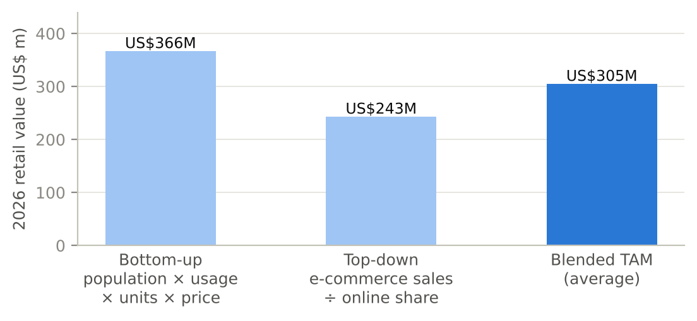
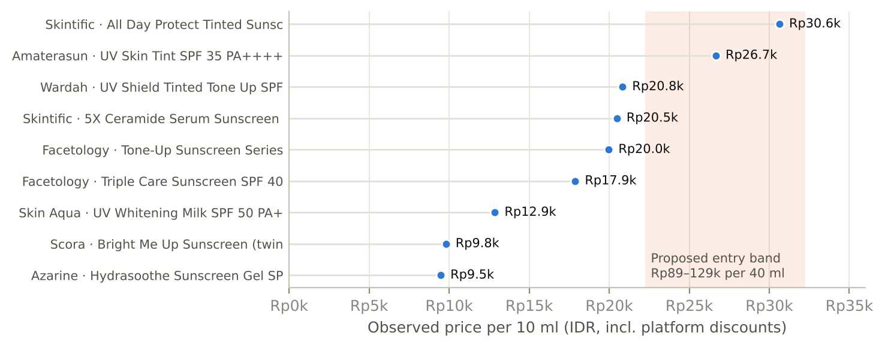
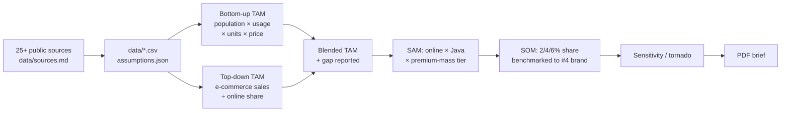
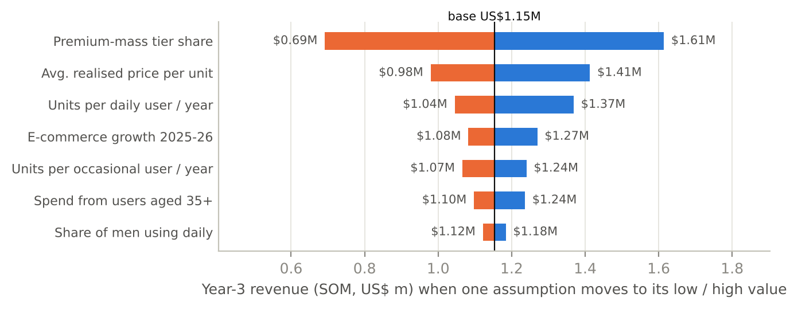

# Indonesia Facial Sunscreen — Market Entry Brief

> Should a Korean sunscreen brand enter Indonesia in 2027? A sourced,
> reproducible market-entry study: sizing (TAM/SAM/SOM with two-way
> triangulation), consumers, competition, pricing, channels, regulation and a
> phased go-to-market plan.

  

📄 **[Read the 10-page brief (PDF)](report/Indonesia_Sunscreen_Market_Entry_Brief.pdf)**

---

## The answer in one paragraph

**Go — as a focused online challenger, not a mass-market launch.** Facial
sunscreen in Indonesia is a **~US$305M** market (range US$243–366M from two
independent methods) that is growing fast, fragmented (top four brands ≈ 26.5% of
e-commerce sales) and sold mostly through Shopee and TikTok Shop. A new
premium-mass brand priced at Rp89–129k per 40 ml can realistically reach
**~US$1.2M a year by year 3** (range US$0.6–1.7M). Regulation (BPOM notification
through a local registrant, halal certification) is the critical path and should
start six months before launch.



## Key findings

| # | Finding | Evidence |
|---|---|---|
| 1 | Market ≈ US$305M (~10% of a ~US$3B skin care market) | Bottom-up (BPS population × Jakpat/Snapcart usage) vs top-down (Compas e-commerce sales) |
| 2 | Online sunscreen sales jumped 72% in six months | Compas: Rp530bn (H2 2023) → Rp914bn (H1 2024) |
| 3 | Only ~35% of women use sunscreen daily, vs 75% who use it at all | Snapcart; Jakpat 2024 |
| 4 | Local brands lead but nobody dominates | Wardah 7.9%, Azarine 6.7%, Facetology 6.7%, Skintific 5.2% (Jan–Sep 2025) |
| 5 | Leaders sell at Rp10–21k per 10 ml; tinted formats reach Rp27–31k | 2026 marketplace price snapshot |
| 6 | Shopee + TikTok Shop/Tokopedia = ~92% of e-commerce GMV | Momentum Works 2025 |
| 7 | Halal for cosmetics: deadline 17 Oct 2026; extension to 2028 proposed on 16 Oct 2026, not yet published | BPJPH via CIRS; REACH24H |



## Method



Principles applied:

- **Every number is either sourced or labelled as an assumption** — `data/assumptions.json` tags each input, and a test fails if one isn't.
- **Two methods, honest gap.** The bottom-up and top-down estimates differ by 41%; the brief reports the range instead of hiding it.
- **Sanity check against an independent total.** The result is ~10% of the published skin care market.
- **Sensitivity before recommendation.** The tornado chart shows the answer depends most on the size of the premium-mass price tier and the average realised price — and the brief proposes how to measure both cheaply.



## Reproduce

```bash
pip install -r requirements.txt
python analysis/market_model.py   # prints TAM/SAM/SOM + sensitivity, writes analysis/results.json
python analysis/charts.py         # report/figures/*.png
python report/build_report.py     # report/Indonesia_Sunscreen_Market_Entry_Brief.pdf
pytest -q                         # 6 tests (inputs match BPS, funnel logic, every URL cited)
```

Change any value in `data/assumptions.json` and rebuild to see a new answer.

## Repository

```
data/
  assumptions.json             every model input, typed sourced / assumption, with low-high ranges
  market_size_estimates.csv    third-party skin care market estimates
  sunscreen_brand_share.csv    Compas brand shares (2025, Q2 2026)
  price_observations.csv       2026 marketplace price snapshot
  sources.md                   all sources with URLs
analysis/
  market_model.py              TAM/SAM/SOM, triangulation, sensitivity
  charts.py                    report figures
report/
  build_report.py              PDF generator (reportlab)
  Indonesia_Sunscreen_Market_Entry_Brief.pdf
tests/test_model.py
```

## Limitations

Desk research only; brand shares cover e-commerce, not offline retail; prices are a
small snapshot; the 68% online-purchase figure is a secondary citation. The client
("Haneul Skin") is fictional — the market data are real and cited.

---

Built by **Nuzul Nur Robbulizzat** · market research & business analysis ·
[LinkedIn](https://linkedin.com/in/nuzulnurri)
